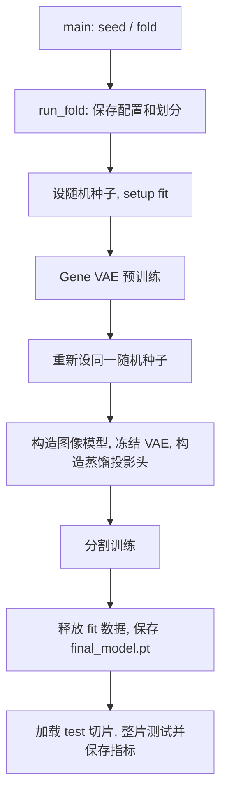

# segmodel 阅读指南

这里的训练分两阶段: 先用表达矩阵预训练 Gene VAE, 再训练 H&E 分割模型。分割训练同时使用离线 PFM 特征、伪标签和冻结的基因教师。动态传播可以在 epoch 结束时更新训练伪标签。

## 从哪里开始读

建议按 `main.py → pipeline.py → training/segmentation_module.py → models/segmentation.py` 阅读, 然后按需要进入数据、条件分支或动态传播实现。

| 想了解的问题 | 入口 |
| --- | --- |
| seed、LOOCV/transfer 和输出目录如何确定 | [main.py](main.py): `get_folds`, `run` |
| 一个 fold 完整做什么 | [pipeline.py](pipeline.py): `run_fold` |
| 每步训练如何组成损失、更新模型 | [training/segmentation_module.py](training/segmentation_module.py): `training_step`, `configure_optimizers` |
| VAE 如何预训练 | [training/gene_module.py](training/gene_module.py) |
| 图像模型输入和输出是什么 | [models/segmentation.py](models/segmentation.py): `SegmentationModel` |
| U-Net 的编码、解码和 skip | [modules/backbone.py](modules/backbone.py): `ConvNeXtUnet` |
| PFM 如何解耦、选择和注入网络 | [modules/conditioning.py](modules/conditioning.py) |
| 图像 spot 如何接受基因监督 | [training/distillation.py](training/distillation.py): `Distiller` |
| 每项损失的具体公式 | [training/losses.py](training/losses.py) |
| 如何读取文件、准备不同训练阶段 | [dataset/loading.py](dataset/loading.py), [dataset/datamodule.py](dataset/datamodule.py) |
| crop 如何采样、增强和配对 spot | [dataset/segmentation.py](dataset/segmentation.py), [dataset/augment.py](dataset/augment.py) |
| MixUp/CutMix 如何同步混合图像和特征 | [training/augment.py](training/augment.py) |
| 动态伪标签何时更新、如何传播 | [dynamic/callback.py](dynamic/callback.py), [dynamic/propagation.py](dynamic/propagation.py) |
| 如何做整片预测和指标计算 | [inference/predictor.py](inference/predictor.py), [inference/validation.py](inference/validation.py) |

## 目录职责

```text
segmodel/
├── main.py                     # Hydra 入口, seed/fold 循环
├── pipeline.py                 # 单 fold 的准备、两阶段训练、保存和测试
├── configs/                    # 原有实验配置, 本次未修改
├── dataset/
│   ├── loading.py              # 文件路径、表达矩阵和整片数据读取
│   ├── slide.py                # Slide/TrainingSlide、对齐取窗、SlideDataset
│   ├── segmentation.py         # 随机 crop、监督/spot 配对、batch collate
│   ├── augment.py              # 单 crop 的图像/几何增强和 PFM 屏蔽
│   └── datamodule.py           # Lightning 数据生命周期和 DataLoader
├── models/
│   ├── gene_vae.py             # GeneVAE 的构造与前向
│   ├── segmentation.py         # 分割网络的组装与前向
│   └── distiller.py            # 旧导入路径兼容, 阅读 training/distillation.py
├── modules/
│   ├── backbone.py             # Stem、ConvNeXt、编码器/解码器
│   ├── conditioning.py         # PFMDecomposer、Router、ConditionalNorm
│   ├── blocks.py               # LayerNorm、Resize、ProjectionHead
│   ├── vae.py                  # VAE 的 MLP、编码器和解码器
│   └── segmentation.py         # 旧导入路径兼容, 阅读 backbone/conditioning
├── training/
│   ├── gene_module.py          # VAE 训练步骤与优化器
│   ├── segmentation_module.py  # 分割训练、优化器、EMA 验证与诊断
│   ├── distillation.py         # spot 池化、冻结教师、分子/关系蒸馏
│   ├── losses.py               # 损失公式
│   ├── augment.py              # batch MixUp/CutMix
│   └── callbacks.py            # epoch 同步与进度显示
├── dynamic/                    # 伪标签更新回调、传播算法、可视化
└── inference/                  # 滑窗预测、专家标注验证、指标、可视化
```

`models` 组装完整网络, `modules` 实现网络内部的层, `training` 处理优化和训练专用监督。没有增加新的配置类、注册器或训练抽象层。

## 一个 fold 的执行顺序



分割 `training_step` 固定按以下顺序计算:

1. 原始 crop 前向, 得到分割、邻接、传播和 PFM 解耦输出。
2. 计算图像损失与 PFM 损失, 按开关计算分子/关系蒸馏。
3. 按 `loss_weights` 的键顺序加权求和。
4. 尝试 MixUp, 再尝试 CutMix; 分别额外前向并加入分割损失。
5. 记录原始 crop 指标与各项损失, 返回总损失。

Lightning 负责 backward、梯度裁剪、AdamW 更新和每 epoch 的学习率调度。`on_train_batch_end` 根据 `global_step` 更新 EMA。`DatasetEpochCallback` 在每轮开始更新数据集的 `epoch`。

| 使用位置 | 使用的模型 |
| --- | --- |
| 原始 crop / MixUp / CutMix 训练 | 普通图像模型 |
| 训练期间留出切片验证 | EMA 模型 |
| 动态传播重新生成伪标签 | 普通图像模型 |
| 最终保存和整片测试 | 普通图像模型 |

动态传播在满足轮次条件时进行整片推理, 按配置重算或复用超像素拓扑, 吸附 spot 并执行随机游走, 然后阈值化概率。只有存在可采样窗口且概率有限时才提交监督更新。该行为沿用原实现。

## 数据与张量约定

设 `B` 为 batch 大小, `C` 为 crop 边长, `L` 为标签网格相对图像的步长, `S` 为 patch 步长, `T` 为 CLS 步长, `K` 为 PFM 个数。

| batch 字段 | 形状 / 类型 | 用途 |
| --- | --- | --- |
| `image` | `(B, 3, C, C)`, uint8 | H&E; 前向内归一化到 `[-1, 1]` |
| `patch` | K 个 `(B, D_i, C/S, C/S)` | PFM 空间特征 |
| `cls` | K 个 `(B, D_i, C/T, C/T)` | PFM 全局上下文 |
| `pfm_mask` | `(B, K)`, bool | True 表示该 PFM 可用 |
| `cancer_probability` | `(B, 1, C/L, C/L)`, float32 | 伪标签概率 |
| `valid` | `(B, 1, C/L, C/L)`, bool | 伪标签不等于 255 的位置 |
| `superpixels` | `(B, 1, C/L, C/L)`, int32 | 超像素编号 |
| `spots` | B 个 `(N_b, 2)` 张量 | crop 内 `(x, y)` 坐标, 单位为图像像素 |
| `gene_expression` | B 个 `(N_b, G)` 张量 | 对应 spot 表达矩阵 |
| `spot_labels` / `spot_ids` | B 个 `(N_b,)` 张量 | spot 标签 / 当前表达矩阵行号 |
| `slide_id` | `(B,)` | 当前 fold 的切片编号 |

不同 crop 的 spot 数不同, 因此 `collate_samples` 将这四个变长字段保留为列表。关系蒸馏只在同一 crop 内合并重复 spot, 不合并跨 crop 的视图。

`SegmentationModel` 返回 `logits`、`affinity_logits`、`features`、`propagation_features` 及 `pfm_*` 统计量。分割网格由原有 Stem 的 `down_factor=7` 决定; 本次没有调整分辨率或模型结构。

## 运行与配置

仍从项目根运行:

```bash
python -m segmodel.main
python -m segmodel.main experiment=her2st seeds='[0]'
```

配置由 `configs/config.yaml` 组合, 实验参数位于 `cfg.experiment` 下。公共分辨率配置读取项目根的 `config/resolution.yaml`。

每个 fold 仍保存 `config.yaml`、`split.json`、`vae/`、`segmentation/`、`final_model.pt`、`test/<slide>/` 和 `metrics.json`; 启用相应流程时还写入 `validation/` 与 `dynamic_pseudo_labels/`。

## 图像骨干初始化

当前 YAML 设置 `experiment.model.image.backbone_init=convnext`:
Stem、编码器和解码器的普通 Conv2d、ConvTranspose2d 和 Linear 权重使用
`torch.nn.init.trunc_normal_(std=0.02)`, bias 为零。
转置卷积使用相同策略是本项目对解码器的扩展。
条件调制头保留全零初始化, 路由器、PFM 解耦层、输出头、Gene VAE 和蒸馏投影头
保留原初始化。LayerNorm 保持 weight=1、bias=0, 残差 gamma 保持 0.01。

局部重置在模型构建完成后执行, 并隔离 CPU RNG, 因此同一 seed 下其他分支、
后续投影头的初始权重和训练随机数状态不随此开关变化。
构造函数默认值仍为 `pytorch`, 兼容缺少此字段的旧模型配置;
训练保存的模型配置会包含本次选择。

```bash
# 当前配置: ConvNeXt 风格的局部初始化
python -m segmodel.main
# 对照实验: 恢复原始初始化, 其余实验配置保持一致
python -m segmodel.main experiment.model.image.backbone_init=pytorch
# 验证局部初始化、随机状态、前反向与权重读写
python -m unittest discover -s tests -p 'test_model_initialization.py' -v
```

此开关只选择初始化方式; 复现 main 还需对齐 seed、切片顺序和验证等训练设置。

## 之前重构的等价性记录

- 重构基线是开始操作时的工作区代码, 包含原先尚未提交的修改。
- 保留参数名称和注册顺序、初始化顺序、随机数调用、损失求和顺序、优化器分组、学习率、EMA、数据加载与增强顺序。
- `ConvNeXtBlock.norm` 虽未用于前向, 仍保留注册, 以免改变 checkpoint 和优化器结构。
- 删除没有调用方的旧 `ConvBlock`、`BlurPool`、`ResidualBlock`、`ModulatedBlock`; 当前训练网络未使用它们。
- 内联 CSV logger 包装、Stem 的临时变量和推理结尾的单次 resize 包装; 原有异常检查和监督更新判断保留。
- 旧 `models.distiller.Distiller` 与 `modules.segmentation` 中现用网络类的导入仍可用。

本次验证: 6,349 个张量零容差一致, 原有 14 个单元测试通过; 107 个函数/类的 AST 在忽略方法声明排列后保持一致, 所有 YAML 配置字节一致。语法编译与 Ruff F 类检查通过。

对照脚本使用两份源码分别运行独立进程, 检查 CPU 合成数据上的 VAE 训练、3 个 epoch 分割训练、梯度、优化器/调度器状态、EMA、增强、随机状态和滑窗推理。要求张量 `rtol=0, atol=0`, 字典键和参数顺序也一致。

```bash
# before 目录中应包含重构前的 segmodel/。
python tests/check_segmodel_equivalence.py /path/to/before
python -m unittest discover -s tests -p 'test_*.py' -v
```

当前会话基线保存在 `/tmp/segmodel_refactor_20261007/before/segmodel`。这是临时快照, 如需长期保留可另行归档。完整真实数据 GPU 训练未执行; 当前环境无法使用 CUDA, 且 PyTorch 的 CPU 抗锯齿缩放不支持 BF16。BF16 对照仅覆盖 VAE 前向和分子/关系蒸馏, 没有替换训练算子来规避此限制。
